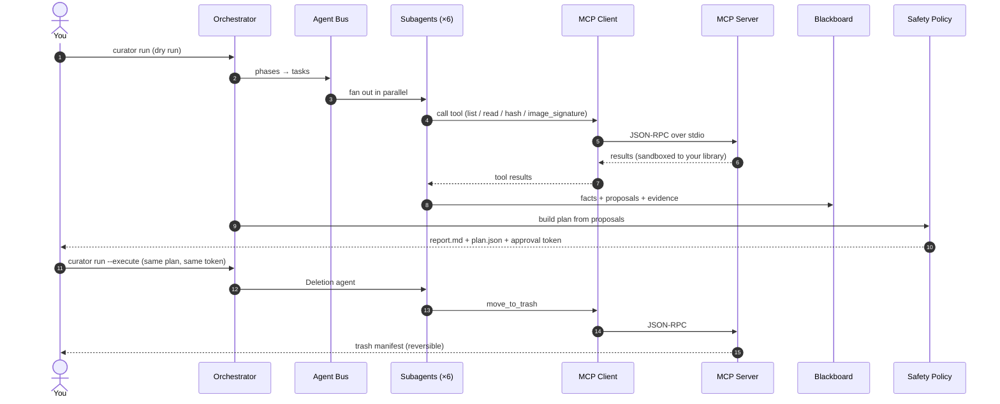

# Architecture · how the agentic workflow runs

<p align="center">
  
</p>

> The picture is animated: the dots travel along each arrow in the order a real run happens. Numbers in the legend match the steps below.

## The eight steps

| # | Step | Where in the code |
| --- | --- | --- |
| 1 | **You start a run.** `curator run --library <folder>` is a dry run by default: it plans, it does not change files. | `cli.py`, `runtime.py` |
| 2 | **The orchestrator plans.** It splits the job into phases (inventory → per-year → documents → duplicates → consolidation → policy review → deletion) and never touches a file itself. | `agents/orchestrator.py` |
| 3 | **The agent bus fans out.** Each phase becomes tasks; the bus routes every task by its kind to the right subagent and runs them in parallel with a concurrency cap. | `core/bus.py` |
| 4 | **Subagents act only through MCP.** Year, Document, Duplicate, Photo, Consolidator and Deletion agents each ask the MCP client to run a tool; none of them opens a file directly. | `agents/*.py`, `mcp_layer/client.py` |
| 5 | **The MCP server does the file work.** Over stdio JSON-RPC it lists, reads, hashes (SHA-256) and fingerprints images (64-bit dHash), sandboxed to your library folder. | `mcp_layer/servers/library_server.py` |
| 6 | **Findings land on the blackboard.** Facts, duplicate groups and proposals (keep / merge / delete) are posted with the evidence that justified them. An LLM gives an optional second opinion. | `core/blackboard.py`, `llm/` |
| 7 | **The safety policy builds a plan you approve.** Dry run, a 0.90 confidence floor, protected paths, a delete cap, and a survivor that must remain for every duplicate group. The plan is sealed with an approval token. | `core/policy.py`, `reporting.py` |
| 8 | **The deletion agent trashes — reversibly.** Only when you re-run with `--execute`, and only for the approved plan, whose token the deletion agent checks: files move to a trash folder with a manifest, so every move can be undone. | `agents/deletion_agent.py` |

## The same flow as a sequence



## Layers at a glance

| Layer | Pieces | Rule it enforces |
| --- | --- | --- |
| Client | You, the CLI | Nothing happens without a run you started; deletion needs your token |
| Agent layer | Orchestrator, Agent Bus, six subagents, Blackboard, Safety Policy, LLM provider | Agents coordinate through the blackboard, not by chatting |
| MCP layer | MCP client session, `library_server` and its tools | Every file operation is a typed tool call inside a sandbox |

## Regenerating the picture

The animated SVG is generated, not hand-drawn:

```bash
python scripts/make_workflow_svg.py   # writes docs/assets/agentic-workflow.svg
```

It uses only SVG + CSS animation (no scripts), which is why GitHub can show it inline.
